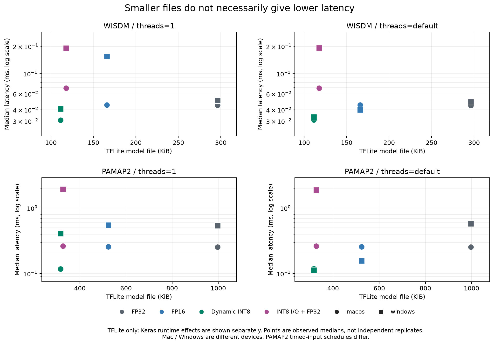

# HAR 모델 양자화 효율 분석

센서로 사람의 행동을 분류하는 HAR(Human Activity Recognition) 모델을 대상으로, **모델 파일을 줄이면 실제 추론시간과 메모리도 줄어드는지** 확인하는 사물인터넷 Project 2입니다. 공개된 패치 기반 Transformer 저장 모델을 평가하고, Mac ARM64·Windows x86-64 CPU에서 실행 방식과 양자화 효과를 비교했습니다.

[프로젝트 쉽게 이해하기](docs/project-explained.md) · [통합 결과와 그래프](results/platform-integration-draft/report.md) · [수행계획서](docs/project-proposal.docx)

## 선정 논문과 원본 저장소

| 자료 | 이 프로젝트에서의 역할 | 원문·정리 |
| --- | --- | --- |
| *A Review of TinyML for Human Activity Recognition on Edge Devices* | TinyML·센서 기반 행동 인식의 배경, 경량화 방법과 평가 지표 조사 | [논문](https://doi.org/10.3390/make8090271) · [쉬운 정리](docs/papers/tinyml-har-survey.md) |
| *Edge efficient human activity recognition using a quantized patch based transformer* | 공개 저장 모델과 전처리 코드를 이용한 평가·양자화 실험의 기준 | [논문](https://doi.org/10.1038/s41598-026-62744-4) · [구조·결과 정리](docs/papers/quantized-patch-transformer.md) |

- **저자 원본 저장소:** [PATCH-BASED-TRANSFORMER-WITH-QUANTIZATION](https://github.com/AASIFRASHIDKHANDAY/PATCH-BASED-TRANSFORMER-WITH-QUANTIZATION)
- 코드·모델 확인 기준: [`90eb53deec3ff166fa0f1e08211d8d9d1770411d`](https://github.com/AASIFRASHIDKHANDAY/PATCH-BASED-TRANSFORMER-WITH-QUANTIZATION/tree/90eb53deec3ff166fa0f1e08211d8d9d1770411d)
- [두 논문이 과제에 이어지는 이유와 읽는 순서](docs/papers/README.md) · [논문·공개 코드 대조](docs/paper-code-check.md)

저자 모델과 원본 노트북 전체는 이 저장소에 재배포하지 않습니다. 아래 안내에 따라 원본 배포처에서 별도로 준비하며, 이용·재배포 조건은 원본 자료를 따릅니다.

## 직접 수행한 작업

저자의 학습된 가중치를 사용했습니다. 모델 재학습이나 새로운 모델 구조 개발은 수행하지 않았으며, 다음의 재현·수정·확장 작업을 진행했습니다.

| 구분 | 수행 내용 | 코드·기록 |
| --- | --- | --- |
| 환경 구성·모델 로드 | 두 OS의 CPU 환경 점검, 모델 해시·입출력 확인. WISDM 커스텀 레이어에 `build()`를 구현해 저장 가중치 로드 경고 해결 | [환경](docs/setup.md) · [레이어](src/har_quantization/layers.py) · [모델 확인](docs/wisdm-model.md) |
| 데이터·전처리 재구성 | 공식 데이터 검증, 공개 코드 기준 구간 생성·분할·표준화 재계산. PAMAP2는 원본 노트북의 전처리 함수 출력과 배열 대조 | [WISDM 전처리](docs/wisdm-preprocessing.md) · [PAMAP2 원본 대조](results/pamap2-preparation/reference-check.json) |
| 전체 평가·논문 비교 | WISDM 5,358개, PAMAP2 494개 평가 구간 전체의 정확도·Macro-F1·혼동행렬 계산 및 논문 수치 대조 | [WISDM 평가](docs/wisdm-evaluation.md) · [PAMAP2 평가](docs/pamap2-macos-results.md) |
| 변환·양자화 | TFLite FP32·FP16·동적 INT8·INT8 입출력 변환, 모델별 예측·크기·잔여 FP32 연산 확인 | [WISDM 양자화](docs/wisdm-quantization.md) · [Windows 변환·양자화](docs/windows-tflite-quantization.md) |
| 비교 실험 확장 | Keras 호출 방식·런타임 변경·양자화 효과를 구분하고, 두 플랫폼·두 스레드 모드의 지연시간·프로세스 메모리 측정 | [실험 규약](docs/experiment-protocol.md) · [WISDM Mac 측정](docs/wisdm-macos-benchmark.md) |
| 결과 통합·검증 | 고정 커밋의 48조건·48,000회 원시 측정을 검증하고 표·개선율·그래프 재생성 | [통합 코드](scripts/integrate_platform_results.py) · [검증 범위와 출처](docs/platform-results-integration.md) |

## 실험 조건과 핵심 결과

| 항목 | 조건 |
| --- | --- |
| 데이터·입출력 | WISDM: 가속도 X·Y·Z, `(80, 3)` → 6행동 / PAMAP2: 심박·3부위 가속도·자이로, `(200, 19)` → 18행동 |
| 실행 방식 | Keras `predict()`, Keras 직접 호출, TFLite FP32, FP16, 동적 INT8, INT8 입출력·일부 FP32 |
| 플랫폼·스레드 | Mac ARM64 / Windows x86-64 CPU, 연산 스레드 1 / 런타임 기본 설정 |
| 측정 | 2데이터 × 6방식 × 2플랫폼 × 2스레드 = **48조건**. 조건마다 별도 프로세스, 배치 1, 워밍업 50회, 측정 1,000회 |
| 지표 | 모델 파일 크기, 정확도·Macro-F1, 중앙 지연시간·p95, 프로세스 피크 메모리 |

**이번 8개 데이터·플랫폼·스레드 조합에서 동적 INT8이 TFLite 변형 중 가장 빨랐습니다.** 아래는 그중 **런타임 기본 설정**의 중앙 지연시간입니다. 감소율은 같은 데이터·플랫폼·스레드의 TFLite FP32 대비입니다.

| 데이터 | 플랫폼 | FP32 (ms) | 동적 INT8 (ms) | 지연시간 감소율 |
| --- | --- | ---: | ---: | ---: |
| WISDM | Mac | 0.044750 | 0.030875 | 31.0% |
| WISDM | Windows | 0.048800 | 0.033300 | 31.8% |
| PAMAP2 | Mac | 0.255625 | 0.119292 | 53.3% |
| PAMAP2 | Windows | 0.579450 | 0.113200 | 80.5% |

1스레드까지 포함한 동적 INT8의 감소율은 **19.1~80.5%**입니다. INT8 입출력 모델은 파일이 작아졌지만 이번 8개 조합 모두 FP32보다 느렸고, 일부 FP32 연산도 남았습니다. 따라서 INT8이라는 이름이나 파일 크기만으로 속도를 판단할 수 없습니다. Keras → TFLite의 런타임 변경 효과는 위 양자화 개선율에 포함하지 않았습니다.



[전체 48조건 표](results/platform-integration-draft/summary.csv) · [40개 개선율 비교](results/platform-integration-draft/effects.csv) · [정확도·p95·메모리·그래프 해설](results/platform-integration-draft/report.md)

### 재현 범위와 해석의 한계

- WISDM Keras 평가는 정확도 **96.771%**, Macro-F1 **95.458%**로 논문 표시 정밀도까지 일치했습니다. PAMAP2는 **97.368% / 96.736%**로 논문의 **98.480% / 97.978%**를 재현하지 못했습니다.
- 원 학습의 분할 인덱스·scaler 통계를 확보하지 못했습니다. 공개 코드 절차로 재계산했으며, 같은 가중치를 확보한 사실만으로 학습 당시 평가 조건까지 같다고 확인할 수는 없습니다.
- 구간 단위 분할로 학습·평가 사이에 센서 시점과 피험자가 중첩됩니다. PAMAP2에는 파일 경계를 가로지르는 구간도 있어 피험자 독립 일반화 성능으로 해석하지 않습니다.
- 두 플랫폼의 전체 평가 입력·정답·분할 배열 해시는 일치합니다. PAMAP2 타이밍 표본은 Mac이 494개 순환, Windows가 복원추출 고유 420개로 다릅니다.
- 플랫폼별 한 장치·세션의 CPU 측정입니다. OS 자체의 우열, MCU 실기기 성능, 전력 절감을 입증한 실험은 아닙니다. 프로세스 피크 메모리는 런타임·입력 등을 포함하며 OS별 계측 방식도 다릅니다.

## 실행 방법

기존 결과 확인과 그래프 재생성은 **A**, 모델부터 직접 실행하려면 **B** 순서로 진행합니다. 모든 명령은 저장소 루트에서 실행합니다.

### 1. 저장소와 환경 준비

```bash
git clone https://github.com/IoT-Kimjangs/har-quantization.git
cd har-quantization
```

검증한 핵심 조합은 **Python 3.12 / TensorFlow 2.21.0 / Keras 3.13.2 / LiteRT 2.3.0**입니다. Python 3.12와 Git을 먼저 설치합니다. `requirements.txt`는 핵심 버전을 고정하며 전체 의존성의 lock 파일은 아닙니다. 실제 설치 버전은 [Mac](requirements/macos-arm64-py312.txt)·[Windows](requirements/windows-amd64-py312.txt)에 기록했습니다.

**Mac Apple Silicon**

```bash
bash scripts/setup_macos.sh
source .venv/bin/activate
```

**Windows PowerShell — 64비트 Python 3.12**

```powershell
py -3.12 -m venv .venv
.venv\Scripts\python.exe -m pip install --index-url https://pypi.org/simple -r requirements.txt
.venv\Scripts\python.exe -m pip check
.venv\Scripts\python.exe scripts/check_environment.py --output .venv/environment.json
```

[환경 구성과 점검 상세](docs/setup.md). 환경 점검의 작은 모델 실행과 실제 HAR 모델 평가는 별도 단계입니다.

### A. 저장된 결과로 표·그래프 재생성

원본 데이터·모델 없이 커밋에 저장된 평가·측정 기록을 읽습니다. 먼저 [고정 출처 설정](configs/platform-result-sources.json)의 커밋을 가져옵니다.

```bash
git fetch origin 2f2b6c04089da5bcd96ccaddbe15251e2253e942 edee959d239bf696832f869f6b523a579a0eead1 cb5d712b2773a4aced0c3893a13141c4687c1c67
```

Mac:

```bash
.venv/bin/python scripts/integrate_platform_results.py --output results/local-platform-check
```

Windows PowerShell:

```powershell
.venv\Scripts\python.exe scripts/integrate_platform_results.py --output results/local-platform-check
```

`results/local-platform-check/report.md`와 CSV·PNG·SVG가 생성됩니다. 기존 출력 폴더가 차 있으면 중단하므로 재실행할 때 새 폴더명을 사용합니다. 통합 스크립트는 Mac에서 검증했으며 Windows 재실행은 확인하지 않았습니다. [검증 항목과 출처 추적](docs/platform-results-integration.md)에 상세히 적었습니다.

### B. 데이터·모델부터 평가·변환·측정

**준비할 자료**

| 자료 | 공식 출처 | 로컬 위치·준비 안내 |
| --- | --- | --- |
| WISDM Activity Prediction v1.1 | [Fordham WISDM](https://www.cis.fordham.edu/wisdm/dataset.php) | `data/raw/wisdm/` · [다운로드·해시 검증](docs/wisdm-data.md) |
| PAMAP2 Protocol + Optional | [UCI PAMAP2](https://doi.org/10.24432/C5NW2H) | `data/raw/pamap2/` · [공식 ZIP·전처리](docs/pamap2-data.md) |
| 저자 WISDM 저장 모델 | 위 고정 커밋의 `models/wisdm_transformer_best_fp32.keras` | 같은 파일명으로 로컬 `models/`에 저장 · [복사 명령·해시·입출력](docs/wisdm-model.md) |
| 저자 PAMAP2 저장 모델 | 위 고정 커밋의 `models/pamap2_transformer_best_fp32.keras` | 같은 파일명으로 로컬 `models/`에 저장 · [해시·채널·전처리 대조](docs/pamap2-macos-results.md) |

데이터·모델·전처리 배열은 Git에 포함되지 않습니다. WISDM은 **모델 준비 후** 다음 순서로 실행합니다. 아래는 Mac 명령이며 Windows에서도 전처리·평가·변환·양자화는 `.venv/bin/python`을 `.venv\Scripts\python.exe`로 바꿔 실행합니다.

```bash
# 공식 원본 확보 → 구간·분할·학습 분할 기준 표준화
.venv/bin/python scripts/prepare_wisdm_data.py --download
.venv/bin/python scripts/prepare_wisdm_preprocessing.py
# 전체 평가 → TFLite FP32 → 세 양자화 변형의 전체 평가
.venv/bin/python scripts/evaluate_wisdm.py --output results/local-wisdm-keras
.venv/bin/python scripts/convert_evaluate_wisdm_fp32.py --output results/local-wisdm-fp32
.venv/bin/python scripts/quantize_evaluate_wisdm.py --output results/local-wisdm-quantization --fp32-result results/local-wisdm-fp32
```

이 과정은 모델 파일과 지표 JSON·예측 CSV를 만듭니다. 기존 변환 모델이나 출력 폴더가 있으면 중단하는 단계가 있으므로, 처음 재현할 때는 새 clone에서 시작합니다. 원본 확보·전처리 단계는 일부 추적 중인 메타데이터를 다시 기록할 수 있으니 실행 후 `git diff`로 확인합니다.

**성능 측정은 해당 OS의 스크립트로 실행합니다.**

```bash
# Mac ARM64
.venv/bin/python scripts/benchmark_wisdm_macos.py --output results/local-macos-wisdm-benchmark
```

```powershell
# Windows
.venv\Scripts\python.exe scripts/benchmark_wisdm_windows.py --output results/local-windows-wisdm-benchmark --fp32-result results/local-wisdm-fp32 --quant-result results/local-wisdm-quantization
```

Mac WISDM 측정은 저장소의 기존 평가·양자화 기록 경로를 참조하며, 재생성한 로컬 모델 해시와 예측이 해당 기록과 일치해야 진행됩니다. Windows는 위 인자로 비교할 기록을 지정합니다. 결과의 `summary.json`과 원시 CSV에서 조건·중앙값·p95·프로세스 메모리를 확인합니다.

PAMAP2는 OS별 전처리·실행 경로가 다릅니다. 공식 ZIP과 모델을 준비한 뒤 아래 안내의 순서로 진행합니다. 기존 결과 경로를 사용하는 명령도 있으므로 출력 경로와 기존 파일을 먼저 확인합니다.

| 실행할 작업 | Mac | Windows |
| --- | --- | --- |
| 데이터·전처리·전체 평가·양자화·측정 | [Mac 재실행 순서](docs/pamap2-macos-results.md#재실행-순서) | [데이터·전처리·Keras 평가](docs/pamap2-data.md) → [변환·양자화](docs/windows-tflite-quantization.md) → [측정 명령·결과](results/2026-11-10-windows-pamap2-benchmark-final/pamap2-windows-results.md) |

## 결과와 작업 기록 찾아보기

| 범위 | 보고서·원시 결과 |
| --- | --- |
| WISDM Mac | [전체 평가](docs/wisdm-evaluation.md) · [FP32 변환](docs/wisdm-tflite-fp32.md) · [양자화](docs/wisdm-quantization.md) · [속도·메모리](docs/wisdm-macos-benchmark.md) |
| PAMAP2 Mac | [전체 보고서와 원시 기록 링크](docs/pamap2-macos-results.md) |
| Windows | [WISDM](results/2026-11-10-windows-wisdm-benchmark-final/windows-results.md) · [PAMAP2](results/2026-11-10-windows-pamap2-benchmark-final/pamap2-windows-results.md) · [환경 기록](results/environment/windows-amd64-2026-11-10.json) |
| 두 플랫폼 통합 | [보고서·그래프](results/platform-integration-draft/report.md) · [집계 코드·검증 범위](docs/platform-results-integration.md) · [고정 출처](results/platform-integration-draft/sources.json) |
| 확장 계획 (발표 후 진행) | [양자화 모델이 느려진 원인 분석](docs/extension-plan.md) |

모델·데이터 준비부터 양자화·측정까지의 실험 기록과 통합 분석을 main에 반영했습니다. 발표·보고서용 해석은 검토 중이며 최종 제출본으로 확정한 상태는 아닙니다. 변경 내용과 리뷰는 [Pull requests](https://github.com/IoT-Kimjangs/har-quantization/pulls)에서 확인합니다.

## 저장소 구성과 협업

- `scripts/`, `src/har_quantization/`: 준비·평가·변환·측정·통합 코드
- `configs/`: 데이터·모델·전처리·벤치마크 조건과 출처 고정
- `docs/`: 쉬운 설명, 논문 정리, 실행 안내, 계획·협업 문서
- `results/`: 환경 기록, 전체 평가, 원시 측정, 통합 표·그래프
- `requirements/`: 플랫폼별 실제 설치 패키지 기록
- `data/`, `models/`: 로컬 원본·처리 배열·모델 보관, 대용량 파일은 Git 제외
- `.github/`: PR·이슈 양식, 리뷰어 설정, 저장소 규칙 명세

| 담당 | 수행 범위 |
| --- | --- |
| 서진정 | Mac 환경·재현·양자화·측정, 두 플랫폼 결과 통합·검증·시각화 |
| 장은성 | Windows 환경·재현·양자화·측정 및 결과 기록 |
| 김가은 | 논문 조사·결과 해석, 보고서·발표 자료 정리 |

[협업 규칙](CONTRIBUTING.md) · [PR 작성·리뷰·머지 절차](docs/pr-guide.md) · [주차별 계획과 완료 기준](docs/project-plan.md)

작업 브랜치에서 PR을 올리고 지정 리뷰어의 승인 1개를 받아 main에 머지합니다. 머지한 브랜치는 자동 삭제합니다. 일정은 계획 문서와 LMS 공지를 함께 확인합니다. 발표자료는 발표 전날 월요일 **오전 11:59**까지 팀당 `.pptx` 1개를 제출하며, 우리 팀의 발표일·해당 마감일은 발표 순서표를 기준으로 확인합니다.
