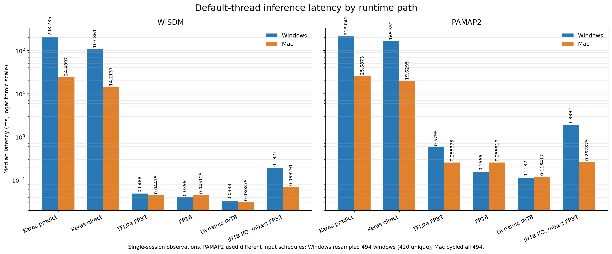

# Platform latency figure

The figure compares default-thread median inference latency for Windows and Mac using the platform result reports. The logarithmic vertical axis makes both Keras and TFLite paths visible in the same panel. Bar labels are milliseconds.



These are observations from one Windows PC and one Mac session, not controlled OS benchmarks. PAMAP2 sampling differs: Windows sampled with replacement from 494 test windows (420 unique), while Mac cycled through all 494. The PAMAP2 bars therefore are not an identical-input comparison. Full conditions and interpretation are in [the runtime and quantization comparison](runtime-quantization-effects.md).

Regenerate the image with:

```bash
.venv/Scripts/python.exe scripts/plot_platform_latency_comparison.py
```
