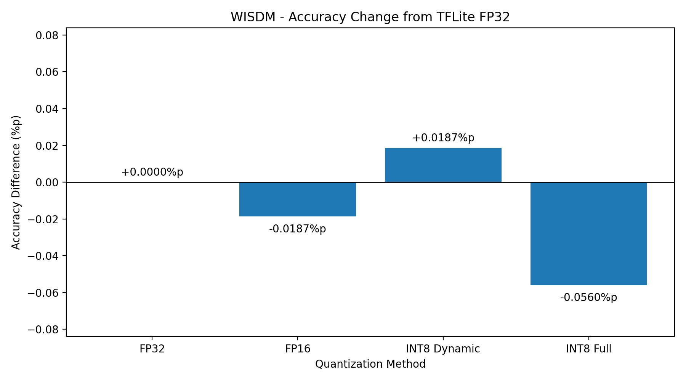
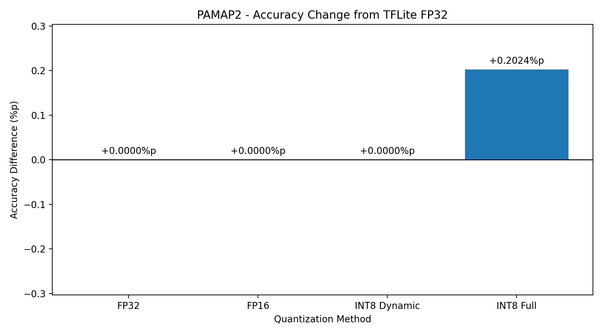
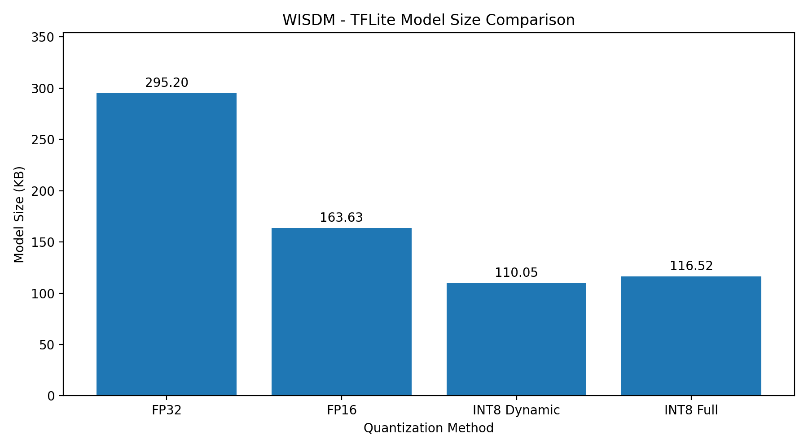
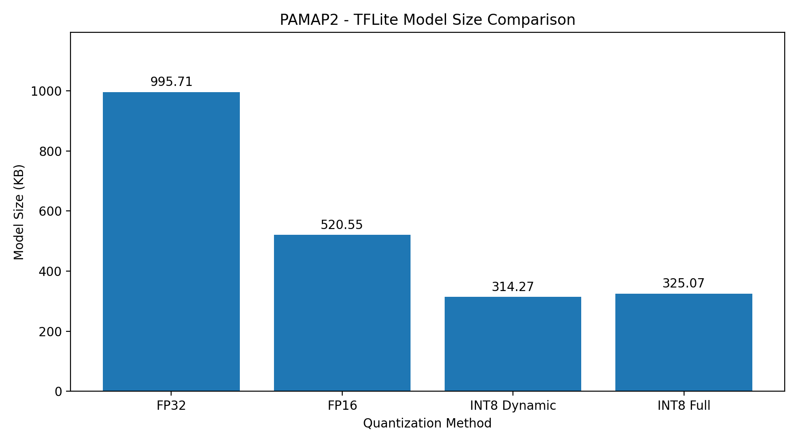
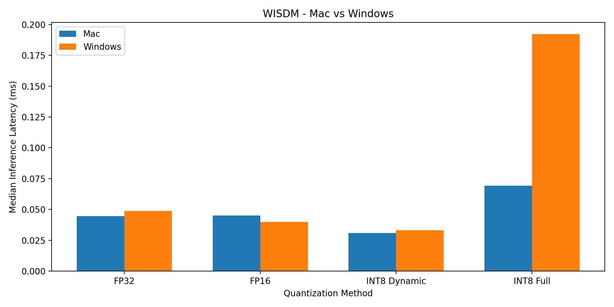
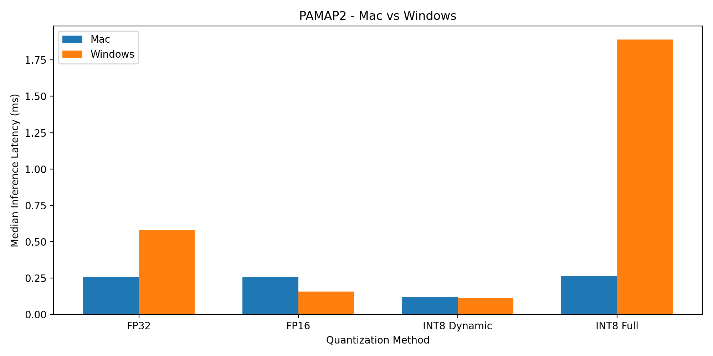
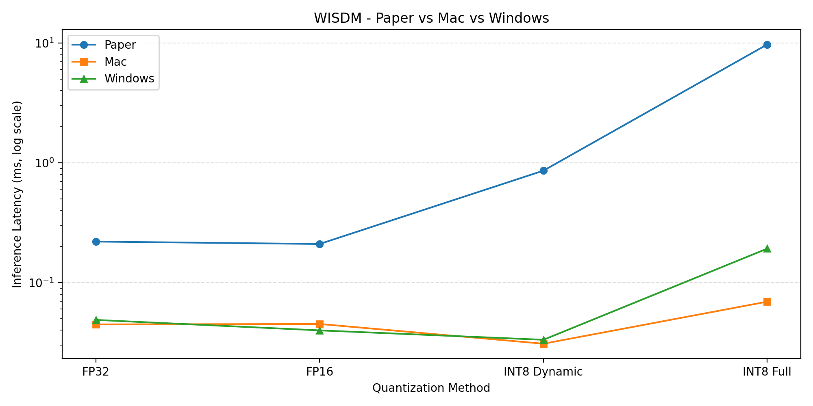
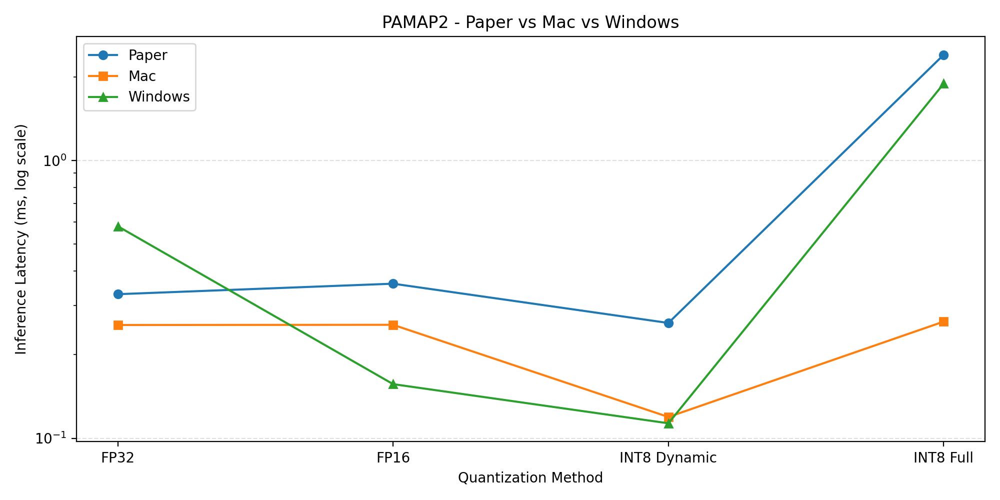
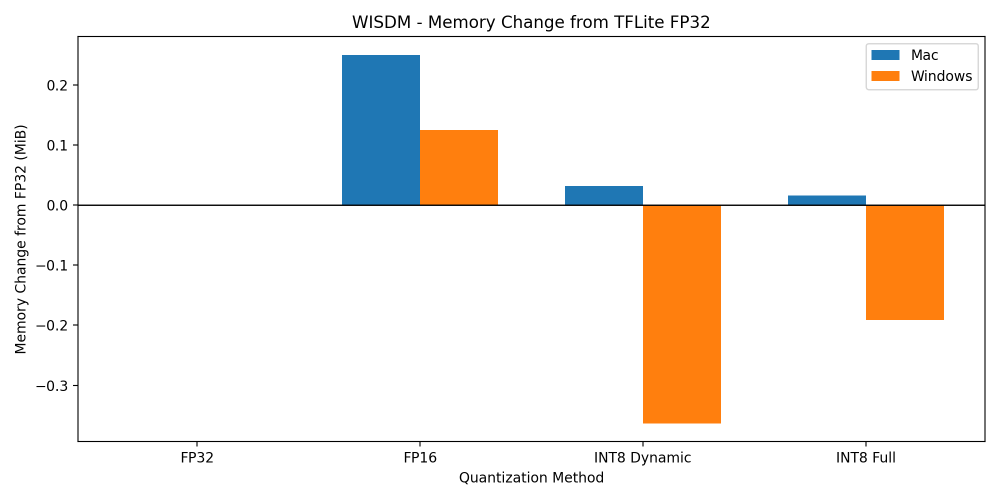
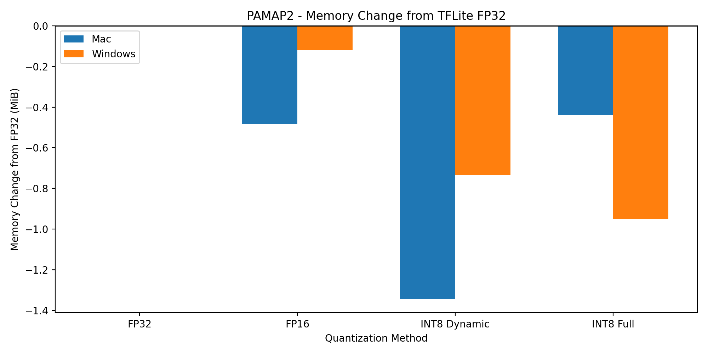

# 패치 기반 Transformer HAR 모델의 양자화 재현 및 플랫폼 확장 실험 분석

> 사물인터넷 Project 2 · 분석 초안  
> 분석 대상: WISDM, PAMAP2 / macOS ARM64, Windows x86-64  
> 원논문: Khanday et al., *Edge efficient human activity recognition using a quantized patch based transformer*, *Scientific Reports* (2026). https://doi.org/10.1038/s41598-026-62744-4

## 1. 분석 목적과 비교 기준

본 실험의 목적은 패치 기반 Transformer를 사용한 인간 행동 인식(HAR) 모델의 양자화가 **정확도, 저장 크기, 추론 지연시간, 실행 메모리**에 미치는 영향을 검증하는 것이다. 원논문에서 보고한 TFLite 변환·양자화 결과를 확인하고, macOS(ARM64)와 Windows(x86-64)의 CPU 환경에서 같은 모델 계열을 측정하여 결과의 재현성과 플랫폼에 따른 경향을 비교하였다.

해석 과정에서는 (1) Keras 호출 방식의 차이, (2) Keras에서 TFLite FP32로 실행 경로가 달라지는 효과, (3) **같은 TFLite 런타임의 FP32를 기준으로 양자화한 효과**를 분리한다. 따라서 Keras 원본 대비 TFLite INT8의 전체 속도 차이를 양자화 자체의 효과로 간주하지 않는다.

## 2. 재현 실험 구성과 검증 범위

| 구분 | 확인된 조건 |
|---|---|
| 데이터셋 | WISDM(평가 윈도우 5,358개), PAMAP2(494개) |
| 실행 경로 | Keras direct, Keras predict, TFLite FP32·FP16·INT8 Dynamic·INT8 Full |
| 실행 환경 | macOS 26.6.2 / ARM64, Windows 11 / AMD64(x86-64) |
| 스레드 설정 | `default`, 명시적 `1` |
| 반복 측정 | 조합별 1,000회; 전체 2 데이터셋 × 2 환경 × 6 실행 경로 × 2 설정 = **48개 조합** |
| 주요 패키지 | TensorFlow 2.21.0, Keras 3.13.2, ai-edge-litert 2.3.0, NumPy 2.5.4 |
| 추론시간 지표 | `median_ms`(중앙값), `p95_ms`, `mean_ms` |

4개 벤치마크 `summary.csv`에서 계획한 48개 조합이 모두 기록되어 있고, `prediction_disagreements_with_prior_full_evaluation`은 모두 0으로 확인되었다. 다만 이 값은 이전 평가와 **예측이 일치했다는 뜻이지, 정답과 모두 일치한다는 뜻은 아니다.** 정확도는 별도 `metrics.json`을 기준으로 해석한다.

WISDM의 Mac·Windows 환경 기록은 동일한 테스트 입력 SHA-256을 가진다. 그러나 CPU 종류와 아키텍처가 다르므로 절대 지연시간의 차이를 운영체제만의 영향으로 해석하지 않는다. 또한 Windows PAMAP2 벤치마크는 494개 테스트 윈도우로 1,000회 측정하며 중복 추출을 허용했고, Mac PAMAP2는 동일한 샘플 선택 방식을 사용했는지 환경 파일에 명시되어 있지 않다.

## 3. 원논문 대비 분류 정확도

**표 1. 원논문과 재현 평가 정확도 비교(%)**

| 데이터셋 | TFLite 형태 | 원논문 | 팀 평가 | 차이(팀 − 원논문, %p) |
|---|---|---:|---:|---:|
| WISDM | FP32 | 96.771 | 96.771 | +0.000 |
| WISDM | FP16 | 96.752 | 96.753 | +0.001 |
| WISDM | INT8 Dynamic | 96.789 | 96.790 | +0.001 |
| WISDM | INT8 Full | 96.771 | 96.715 | −0.056 |
| PAMAP2 | FP32 | 98.480 | 97.368 | −1.112 |
| PAMAP2 | FP16 | 98.480 | 97.368 | −1.112 |
| PAMAP2 | INT8 Dynamic | 98.379 | 97.368 | −1.011 |
| PAMAP2 | INT8 Full | 97.974 | 97.571 | −0.403 |

원논문 수치는 논문 표 5·6을 기준으로 하고, 팀 평가는 공유된 양자화 `metrics.json`을 기준으로 소수 셋째 자리까지 표기하였다. WISDM의 Mac·Windows 정확도 및 예측 결과 해시는 일치한다. PAMAP2의 Mac·Windows 폴더에 기록된 정확도 역시 일치하지만, Windows 파일에서 독립 평가를 재실행했는지는 추가 확인이 필요하다.

WISDM은 원논문과 대체로 유사한 정확도를 보였다. 동일한 팀 FP32를 기준으로 하면 FP16 **−0.0187%p**, INT8 Dynamic **+0.0187%p**, INT8 Full **−0.0560%p**로, 모두 변화가 작다. PAMAP2에서는 FP16과 INT8 Dynamic의 정확도가 FP32와 동일한 97.3684%였으며, INT8 Full은 97.5709%로 **+0.2024%p**였다. 다만 평가 윈도우 494개에서 정답 1개에 해당하는 차이이므로, 양자화로 일반적 정확도가 개선됐다고 단정하기 어렵다.

PAMAP2 FP32의 원논문 대비 **−1.112%p** 차이는 추가 검토 대상이다. 전처리·데이터 분할·평가에 사용된 저장 모델과 논문 학습 설정이 일치하는지 확인하기 전에는 특정 원인을 확정할 수 없다. 현재 양자화 평가 로그의 `training_executed: false`는 **그 작업에서 재학습하지 않았음**을 뜻하며, 팀 전체에서 별도의 재학습을 수행하지 않았다고 단정하는 근거는 아니다.

## 4. 모델 저장 크기와 압축 효과

**표 2. 팀에서 확보한 TFLite 모델 파일 크기**

| 데이터셋 | 형태 | 파일 크기(bytes) | FP32 대비 감소율 |
|---|---|---:|---:|
| WISDM | FP32 | 303,276 | 기준 |
| WISDM | FP16 | 169,752 | 44.03% |
| WISDM | INT8 Dynamic | 113,880 | 62.45% |
| WISDM | INT8 Full | 120,520 | 60.26% |
| PAMAP2 | FP32 | 1,020,888 | 기준 |
| PAMAP2 | FP16 | 536,032 | 47.49% |
| PAMAP2 | INT8 Dynamic | 323,456 | 68.32% |
| PAMAP2 | INT8 Full | 334,520 | 67.23% |

파일 크기 감소율은 `(TFLite FP32 크기 − 양자화 모델 크기) / TFLite FP32 크기 × 100`으로 계산하였다. 두 데이터셋 모두 INT8 Dynamic이 가장 작은 저장 파일을 생성하였다. 이는 초소형 장치에서 모델을 저장하는 데 필요한 공간을 줄이는 데 유리할 가능성을 보여 준다. 다만 **모델 저장 크기와 실행 중 점유 메모리는 별개의 지표**이다.

원논문에 제시된 큰 압축 배율은 원본 Keras 파일과 TFLite 모델을 비교한 결과이며, 여기서 제시한 감소율은 동일한 TFLite 형식의 FP32를 기준으로 한 결과이다. 논문의 KB 표기와 본 실험의 원시 bytes 간 단위·직렬화 차이도 고려해야 한다.

## 5. 추론 지연시간과 플랫폼별 경향

**표 3. 원논문과 팀 실험의 TFLite 지연시간 중앙값(ms)**

| 데이터셋 | 형태 | 원논문 | Mac | Windows |
|---|---|---:|---:|---:|
| WISDM | FP32 | 0.22 | 0.04475 | 0.04880 |
| WISDM | FP16 | 0.21 | 0.04513 | 0.03990 |
| WISDM | INT8 Dynamic | 0.86 | 0.03088 | 0.03330 |
| WISDM | INT8 Full | 9.73 | 0.06929 | 0.19210 |
| PAMAP2 | FP32 | 0.33 | 0.25563 | 0.57945 |
| PAMAP2 | FP16 | 0.36 | 0.25604 | 0.15660 |
| PAMAP2 | INT8 Dynamic | 0.26 | 0.11929 | 0.11320 |
| PAMAP2 | INT8 Full | 2.40 | 0.26292 | 1.88920 |

팀 실험값은 `thread_mode=default`, `iterations=1000` 행의 `median_ms`이다. 원논문과 팀 실험은 CPU·운영체제·측정 구현이 다르므로 **절대값을 직접 비교해 재현 성공 여부나 기기 우열을 판정하지 않는다.** 대신 동일 환경에서 FP32 대비 변화를 비교한다.

**표 4. INT8 Dynamic 적용 시 TFLite FP32 대비 지연시간 감소율**

| 데이터셋 | Mac | Windows |
|---|---:|---:|
| WISDM | 31.0% | 31.8% |
| PAMAP2 | 53.3% | 80.5% |

이 실험에서 INT8 Dynamic은 두 데이터셋, 두 플랫폼에서 모두 TFLite FP32보다 빠르게 측정되었다. 반면 INT8 Full은 WISDM Mac에서 약 1.55배, Windows에서 약 3.94배, PAMAP2 Mac에서 약 1.03배, Windows에서 약 3.26배 느렸다. 특히 원논문 WISDM에서는 INT8 Dynamic이 FP32보다 느렸지만 팀 실험에서는 더 빨랐다. 이러한 순위 차이는 양자화의 속도 효과가 **실행 경로와 하드웨어 환경에 종속될 수 있음**을 보여 준다. 다만 특정 연산자나 CPU 기능이 차이의 직접 원인인지까지 입증한 것은 아니다.

또한 `keras_direct`와 `keras_predict`는 동일한 모델이라도 서로 다른 호출 오버헤드를 포함한다. Keras와 TFLite 간 큰 지연시간 차이를 모두 양자화 효과로 설명해서는 안 된다. Windows PAMAP2에서는 `default`와 `1` 설정 간 지연시간 차이가 일부 형태에서 크게 나타났으므로 스레드 설정도 함께 보고해야 한다.

## 6. 실행 메모리와 측정상의 한계

**표 5. TFLite FP32 대비 프로세스 피크 메모리 변화(MiB)**

| 데이터셋·환경 | FP16 | INT8 Dynamic | INT8 Full |
|---|---:|---:|---:|
| WISDM · Mac | +0.250 | +0.031 | +0.016 |
| WISDM · Windows | +0.125 | −0.363 | −0.191 |
| PAMAP2 · Mac | −0.484 | −1.344 | −0.438 |
| PAMAP2 · Windows | −0.121 | −0.734 | −0.949 |

Mac은 `native_peak_rss_bytes`, Windows는 `peak_working_set_bytes`를 사용하였다. 두 지표의 정의가 완전히 같지 않으므로 서로 다른 OS의 절대 메모리 값을 동등한 기준으로 취급하지 않는다. 또한 변동 폭이 대체로 1MiB 안팎으로 작아 실행 상태·할당 방식·측정 변동성의 영향을 무시할 수 없다. 본 표는 각 플랫폼 **내부에서** FP32와 양자화 형태를 비교하기 위한 참고 결과다.

## 7. 해석상의 제약 및 추가 확인 사항

1. **완전 정수 연산 미달성.** WISDM과 PAMAP2의 INT8 Full 모델은 입력·출력 dtype이 INT8이지만 `integer_only_achieved: false`로 기록되었고, `DEQUANTIZE → NEG → QUANTIZE` 구간 등 부동소수점 연산이 남아 있다. 이 사실만으로 지연시간 증가의 원인을 단정해서는 안 되며, 연산별 프로파일링이 필요하다.
2. **재학습 및 전처리 재현 범위.** 양자화 평가 파일은 해당 단계에서 재학습하지 않았음을 기록한다. 수행계획서의 기준 모델 재학습 목표를 충족했는지, PAMAP2의 저장 모델·전처리·분할이 논문과 동일한지 팀원 확인이 필요하다.
3. **PAMAP2 측정 샘플.** Windows는 평가 윈도우 494개에서 복원추출을 허용해 1,000회 측정했다. Mac의 샘플링 규칙이 같은지, Windows PAMAP2 정확도 파일이 독립적으로 생성됐는지 확인해야 한다.
4. **시스템 상태 통제 제한.** 백그라운드 프로세스, CPU 주파수, 발열 상태를 통제하지 않았고 Mac CPU 모델명은 환경 파일에 기록되지 않았다. 따라서 플랫폼 격차를 OS 하나의 영향으로 해석할 수 없다.
5. **TinyML 실기기 검증 부재.** 결과는 일반 CPU에서 얻은 값이다. MCU·스마트워치에서의 실제 RAM 제약, 배터리 소모, 전력 효율, 지속 추론 성능은 검증되지 않았다.
6. **데이터 분할의 일반화 문제.** 원논문의 중첩 윈도우와 윈도우 단위 분할 방식은 인접 구간 또는 동일 피험자 정보가 학습·평가 집합에 공유될 가능성을 점검할 필요가 있다. 실제 누수가 발생했다고 확정할 근거는 아직 없다.

## 8. 종합 결론

48개 조합의 벤치마크 기록을 분석한 결과, **INT8 Dynamic은 두 데이터셋 모두에서 TFLite FP32 대비 파일 크기를 약 62~68% 축소하고, Mac·Windows CPU에서 추론시간을 약 31~81% 단축**하면서 평가 정확도를 거의 유지하였다. 반면 INT8 Full은 비슷한 수준으로 파일을 축소했으나 추론시간은 증가했고, 실제 연산 그래프도 완전한 정수 연산으로 구성되지 않았다. 따라서 양자화 효율은 정밀도 비트 수만으로 판단할 수 없으며, 정확도와 저장 크기뿐 아니라 실제 런타임, 하드웨어, 연산 지원, 메모리 사용을 함께 평가해야 한다.

본 실험은 원논문의 양자화 결과를 플랫폼별로 확장하여 **Keras 호출 경로와 TFLite 기준선의 차이**, **같은 TFLite 런타임 내부의 양자화 효과**, **플랫폼별 성능 경향**을 분리해 검토한 데 의의가 있다. 다만 PAMAP2의 원논문 대비 정확도 차이, 입력 샘플링의 일치 여부, 재학습 범위, INT8 Full 연산 구성은 추가 검증이 필요하며, 실제 초소형 IoT 장치에 대한 배포 가능성은 별도 실기기 검증을 통해 판단해야 한다.

## 9. 근거 자료 및 확인 항목

- 원논문: https://doi.org/10.1038/s41598-026-62744-4 (주요 표 4~8)
- 프로젝트 연구 정리: `docs/papers/quantized-patch-transformer.md`
- 모델별 정확도: `results/2026-11-10-macos-wisdm-quantization/metrics.json`, `results/2026-11-10-macos-pamap2-models/metrics.json` 및 Windows 대응 파일
- 실행시간·메모리: `results/2026-11-10-*-benchmark*/summary.csv`
- 실행환경: `results/2026-11-10-*-benchmark*/environment.json`
- 시각화 생성 코드: `analysis/plot_paper_results.py`, `analysis/compare_platforms.py`, `analysis/plot_accuracy.py`

**팀원 검토 후 확정할 사항:** (a) 기준 모델 별도 재학습 수행 여부, (b) PAMAP2 Mac·Windows 측정 시 샘플 추출 규칙과 독립 정확도 평가 여부, (c) 원논문의 단위·측정 구간 및 공개 모델과의 일치 범위.
