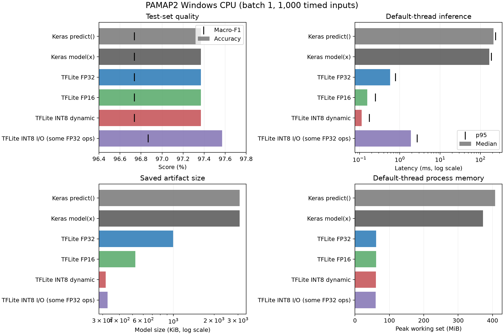

# Windows PAMAP2 실험 결과

2026-11-10 실행. 본 Windows PC의 CPU 결과이며 다른 장치나 Windows 전체 성능을 대표하지 않습니다.

## 환경과 측정 조건

- Windows AMD64, Python 3.12.10, CPU `Intel64 Family 6 Model 140 Stepping 1, GenuineIntel`, 8 논리 CPU, RAM 15.68 GiB
- TensorFlow 2.21.0, Keras 3.13.2, LiteRT 2.3.0
- batch size 1, 워밍업 50회, 측정 1,000회. 1-thread와 기본 스레드를 독립 프로세스에서 각각 실행
- 테스트 분할은 494개 윈도우이므로 벤치마크 1,000개 입력은 seed 42로 복원추출
- 전원 프로필은 Samsung Mode. 백그라운드 부하·CPU 주파수·온도 상태는 통제하지 않음
- 지연시간은 추론 호출과 텐서 입출력을 포함하고 모델 로드·파일 I/O는 제외. INT8의 입력 양자화·출력 역양자화는 포함
- peak 메모리는 모델·런타임·입력 배열을 포함한 독립 워커의 Windows peak working set

## 평가·크기·기본 스레드 성능

| 실행 경로 | 파라미터 수 | 정확도 (%) | Macro-F1 (%) | 파일 크기 (KiB) | 중앙 지연 (ms) | p95 (ms) | Peak 메모리 (MiB) |
|---|---:|---:|---:|---:|---:|---:|---:|
| Keras predict() | 244,434 | 97.368 | 96.736 | 3081.1 | 213.0406 | 238.1586 | 407.9 |
| Keras model(x) | 244,434 | 97.368 | 96.736 | 3081.1 | 165.5518 | 188.1442 | 372.6 |
| TFLite FP32 | 244,434 | 97.368 | 96.736 | 997.0 | 0.5795 | 0.7817 | 61.4 |
| TFLite FP16 | 244,434 | 97.368 | 96.736 | 523.5 | 0.1566 | 0.2494 | 61.2 |
| TFLite INT8 dynamic | 244,434 | 97.368 | 96.736 | 315.9 | 0.1132 | 0.1754 | 60.6 |
| TFLite INT8 I/O (some FP32 ops) | 244,434 | 97.571 | 96.867 | 326.7 | 1.8892 | 2.7230 | 60.4 |

크기는 Keras `.keras` 또는 각 TFLite `.tflite` 모델 파일 기준입니다. 두 기준별 크기 감소와 1-thread 수치는 `pamap2-windows-results.csv`에 있습니다.

## 해석과 한계

- 저장된 Keras 기준 모델은 테스트 494개에서 정확도 97.368%, Macro-F1 96.736%를 기록했습니다. 논문의 98.48%는 다른 평가 설정의 참고값이며 직접 동등 비교할 수 없습니다.
- 저자 노트북의 recursive file loading을 재현해 Protocol과 Optional의 14개 파일을 정렬·연결한 다음 결측·무한대와 activity 0을 제거하고 윈도우화했습니다. 파일/피험자 경계를 보존하지 않아 일부 윈도우가 경계를 넘을 수 있습니다.
- 저자 노트북처럼 윈도우 단위 stratified random split을 사용했습니다. 겹치는 샘플과 같은 피험자가 train/test 양쪽에 포함될 수 있어 피험자 독립 성능이 아닙니다.
- 원 학습 scaler 아티팩트를 확보하지 못해 저장 모델 학습 당시 표준화 통계와 같은지 검증하지 못했습니다. 재학습은 하지 않았습니다.
- INT8 I/O는 입력과 출력이 INT8이지만 일부 연산은 FP32를 포함할 수 있어 “완전 정수 연산”으로 부르지 않습니다.
- 각 측정 경로의 추론 라벨을 전체 평가 저장 예측과 대조했습니다. 1,000회 복원추출 벤치마크 자체는 새로운 정확도 평가가 아닙니다.

## 원시 기록과 재현

- 측정 환경·의존성: `environment.json`, `requirements.txt`; 반복 지연: `*-default.csv`, `*-1.csv`; 케이스 로그·JSON 및 요약 파일은 이 폴더에 있습니다.
- 전처리: `.venv\Scripts\python.exe scripts\prepare_pamap2_preprocessing.py`; 평가: `.venv\Scripts\python.exe scripts\evaluate_pamap2.py`
- 변환·평가: `.venv\Scripts\python.exe scripts\quantize_evaluate_pamap2.py`; 벤치마크: `.venv\Scripts\python.exe scripts\benchmark_pamap2_windows.py`
- 표와 그림: `.venv\Scripts\python.exe scripts\summarize_pamap2_results.py`
