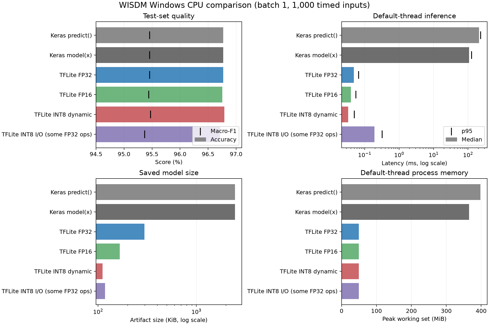

# Windows WISDM 실험 결과

2026-11-10 실행. 본 PC의 CPU 결과이며 다른 PC나 Windows 전체의 성능을 대표하지 않습니다.

## 환경과 조건

- Windows 11, AMD64, Python 3.12.10, 8 논리 CPU, 약 15.68 GiB RAM
- TensorFlow 2.21.0, Keras 3.13.2, LiteRT 2.3.0, NumPy 2.5.4
- 실제 WISDM 테스트 입력, batch size 1, 워밍업 50회, 측정 1,000회
- 1-thread와 기본 스레드 설정을 각각 새 프로세스에서 실행. 표의 지연시간은 기본 설정이며 두 설정 모두 CSV에 포함
- 전원 프로필은 Samsung Mode. 백그라운드 부하·CPU 주파수·열 상태는 통제하지 않음
- 지연시간에는 추론 호출과 텐서 입출력이 포함되며 모델 로드와 파일 I/O는 제외
- 메모리는 런타임·모델·입력을 포함한 각 프로세스의 Windows peak working set

## 정확도·크기·기본 스레드 성능

| 실행 경로 | 파라미터 수 | 정확도 (%) | Macro-F1 (%) | 파일 크기 (KiB) | 중앙 지연 (ms) | p95 (ms) | Peak 메모리 (MiB) |
|---|---:|---:|---:|---:|---:|---:|---:|
| Keras predict() | 200,006 | 96.771 | 95.458 | 2474.4 | 208.7349 | 232.8478 | 397.7 |
| Keras model(x) | 200,006 | 96.771 | 95.458 | 2474.4 | 107.8605 | 127.3229 | 365.6 |
| TFLite FP32 | 200,006 | 96.771 | 95.458 | 296.2 | 0.0488 | 0.0666 | 49.5 |
| TFLite FP16 | 200,006 | 96.753 | 95.440 | 165.8 | 0.0399 | 0.0559 | 49.6 |
| TFLite INT8 dynamic | 200,006 | 96.790 | 95.474 | 111.2 | 0.0333 | 0.0503 | 49.1 |
| TFLite INT8 I/O (some FP32 ops) | 200,006 | 96.715 | 95.368 | 117.7 | 0.1921 | 0.3218 | 49.3 |

Keras 파일 크기는 `.keras`, 나머지는 각 `.tflite` 기준입니다. 압축률과 스레드별 전체 지표는 `windows-results.csv`를 참조합니다.

## 해석과 한계

- FP32 Keras 평가는 테스트 5,358개 중 5,185개 정답, 정확도 96.771%, Macro-F1 95.458%입니다. 논문 표의 반올림 수치와 근접합니다.
- 재학습하지 않았습니다. 원 학습 scaler 파일을 찾지 못해 표준화 통계가 원 모델 학습과 일치하는지는 확인하지 못했습니다.
- 윈도우 단위 분할이라 같은 사용자와 인접 윈도우의 원본 센서 샘플이 학습·테스트에 함께 있습니다. 피험자 독립 일반화 성능으로 해석하지 않습니다.
- INT8 I/O 변형은 입출력이 INT8이지만 일부 연산에 FP32 경로가 남아 완전 정수 연산 모델은 아닙니다.
- 각 경로의 벤치마크 1,000개 예측 라벨은 전체 평가의 라벨과 모두 일치했습니다. 이는 별도의 전체 정확도 평가가 아닙니다.

## 원시 기록과 재현

- 환경: `environment.json`; 의존성: `requirements.txt`; 반복별 지연: `*-default.csv`, `*-1.csv`
- 전체 요약: `summary.csv`, `summary.json`; 케이스별 로그와 JSON도 이 폴더에 보관
- 표와 그림 재생성: `.venv\Scripts\python.exe scripts\summarize_windows_results.py`
- 전체 조건은 [실험 규약](../../docs/experiment-protocol.md), [모델 안내](../../docs/wisdm-model.md), [데이터 안내](../../docs/wisdm-data.md)을 참조
Worker logs are local execution records and are not included in Git; committed per-case JSON and CSV files contain the retained measurements.
