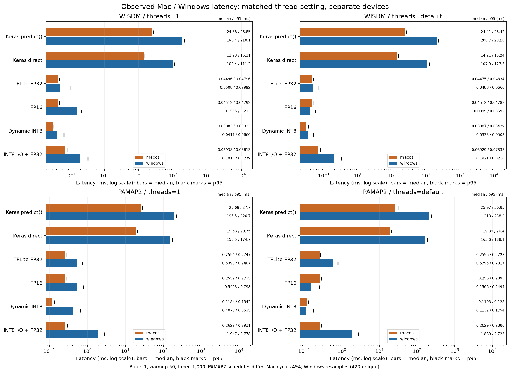
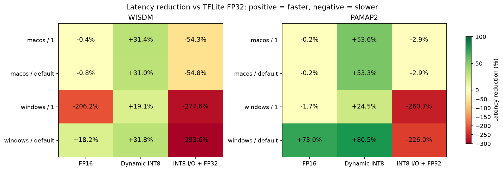

# Mac·Windows 통합 결과 초안

새 추론 실험이 아니라 검증된 PR #7·#14·#17의 고정 커밋에서 원시 CSV와 JSON을 읽어 만든 통합 분석입니다. 선행 실험 PR #7·#14·#17은 main에 반영됐습니다. 이 문서는 최종 제출본이 아닌 검토용 분석 초안입니다. 고정 커밋과 출처는 sources.json, 최신 승인/머지 상태는 각 PR에서 확인합니다.

## 핵심 결과

- 두 데이터셋·두 플랫폼의 1스레드/기본 설정 모두 동적 INT8이 TFLite 변형 중 중앙 지연시간이 가장 짧았습니다.
- Keras에서 TFLite FP32로 바꿀 때의 변화가 양자화 변화보다 큽니다. 런타임·호출·텐서 처리 차이가 포함되므로 양자화 효과로 부르지 않습니다.
- 파일이 작아져도 추론이 빨라진다고 보장할 수 없습니다. 크기 감소율과 지연시간 변화는 effects.csv에서 별도로 계산했습니다.
- INT8 입출력 모델은 일부 FP32 연산을 포함하며, 이번 모든 조건에서 TFLite FP32보다 느렸습니다. 원인 분해/프로파일링은 하지 않았습니다.
- FP16의 이득은 일정하지 않습니다. Windows WISDM은 기본 설정에서 약 18.2% 빨랐지만 연산 스레드 1에서는 약 206.2% 느렸습니다. Windows PAMAP2도 기본 설정에서 약 73.0% 빨랐지만 스레드 1에서는 약 1.7% 느렸습니다. 원인을 스레드나 OS 하나로 확정하지 않습니다.
- 작은 정확도 변화는 평가 구간 몇 개의 차이입니다. 재학습이나 일반적인 정확도 향상을 입증한 결과가 아닙니다.

## 정확도·크기

전체 평가셋 기준이며 벤치마크 표본의 정확도가 아닙니다. Keras 두 호출 방식은 같은 저장 모델·전체 평가 값을 사용합니다.

| 데이터 | 모델 | Mac 정확도/F1 (%) | Windows 정확도/F1 (%) | Mac/Windows 크기 (KiB) |
| --- | --- | ---: | ---: | ---: |
| WISDM | Keras direct | 96.771 / 95.458 | 96.771 / 95.458 | 2474.407 / 2474.407 |
| WISDM | TFLite FP32 | 96.771 / 95.458 | 96.771 / 95.458 | 296.168 / 296.168 |
| WISDM | FP16 | 96.753 / 95.440 | 96.753 / 95.440 | 165.773 / 165.773 |
| WISDM | Dynamic INT8 | 96.790 / 95.474 | 96.790 / 95.474 | 111.211 / 111.211 |
| WISDM | INT8 I/O + FP32 | 96.715 / 95.368 | 96.715 / 95.368 | 117.695 / 117.695 |
| PAMAP2 | Keras direct | 97.368 / 96.736 | 97.368 / 96.736 | 3081.139 / 3081.139 |
| PAMAP2 | TFLite FP32 | 97.368 / 96.736 | 97.368 / 96.736 | 996.961 / 996.961 |
| PAMAP2 | FP16 | 97.368 / 96.736 | 97.368 / 96.736 | 523.469 / 523.469 |
| PAMAP2 | Dynamic INT8 | 97.368 / 96.736 | 97.368 / 96.736 | 315.875 / 315.875 |
| PAMAP2 | INT8 I/O + FP32 | 97.571 / 96.867 | 97.571 / 96.867 | 326.680 / 326.680 |

## 기본 설정의 지연시간·프로세스 메모리

ms는 중앙값/p95, MiB는 프로세스 피크입니다. macOS는 native peak RSS, Windows는 peak working set이므로 OS 간 메모리 절대값/절감률을 직접 비교하지 않습니다.

| 데이터 | 실행 경로 | Mac 중앙값/p95 (ms) | Windows 중앙값/p95 (ms) | Mac 피크 (MiB) | Windows 피크 (MiB) |
| --- | --- | ---: | ---: | ---: | ---: |
| WISDM | Keras predict() | 24.409667 / 26.422188 | 208.734950 / 232.847775 | 494.56 | 397.73 |
| WISDM | Keras direct | 14.213708 / 15.243277 | 107.860450 / 127.322850 | 468.70 | 365.62 |
| WISDM | TFLite FP32 | 0.044750 / 0.048338 | 0.048800 / 0.066605 | 50.31 | 49.50 |
| WISDM | FP16 | 0.045125 / 0.047877 | 0.039900 / 0.055925 | 50.56 | 49.63 |
| WISDM | Dynamic INT8 | 0.030875 / 0.034294 | 0.033300 / 0.050300 | 50.34 | 49.14 |
| WISDM | INT8 I/O + FP32 | 0.069291 / 0.078377 | 0.192100 / 0.321810 | 50.33 | 49.31 |
| PAMAP2 | Keras predict() | 25.970730 / 30.846942 | 213.040600 / 238.158585 | 511.72 | 407.86 |
| PAMAP2 | Keras direct | 19.391375 / 20.397198 | 165.551800 / 188.144155 | 485.94 | 372.60 |
| PAMAP2 | TFLite FP32 | 0.255625 / 0.272274 | 0.579450 / 0.781695 | 68.52 | 61.36 |
| PAMAP2 | FP16 | 0.256042 / 0.289460 | 0.156600 / 0.249430 | 68.03 | 61.24 |
| PAMAP2 | Dynamic INT8 | 0.119292 / 0.128047 | 0.113200 / 0.175445 | 67.17 | 60.63 |
| PAMAP2 | INT8 I/O + FP32 | 0.262917 / 0.288602 | 1.889200 / 2.722965 | 68.08 | 60.41 |

## 연산 스레드 1의 지연시간·프로세스 메모리

ms는 중앙값/p95, MiB는 프로세스 피크입니다. macOS는 native peak RSS, Windows는 peak working set이므로 OS 간 메모리 절대값/절감률을 직접 비교하지 않습니다.

| 데이터 | 실행 경로 | Mac 중앙값/p95 (ms) | Windows 중앙값/p95 (ms) | Mac 피크 (MiB) | Windows 피크 (MiB) |
| --- | --- | ---: | ---: | ---: | ---: |
| WISDM | Keras predict() | 24.575458 / 26.854384 | 190.433050 / 210.053365 | 492.16 | 391.21 |
| WISDM | Keras direct | 13.933104 / 15.109987 | 100.425750 / 111.229830 | 468.11 | 360.74 |
| WISDM | TFLite FP32 | 0.044958 / 0.047959 | 0.050800 / 0.099920 | 50.53 | 48.86 |
| WISDM | FP16 | 0.045125 / 0.047919 | 0.155550 / 0.213025 | 50.25 | 49.22 |
| WISDM | Dynamic INT8 | 0.030834 / 0.033333 | 0.041100 / 0.066600 | 50.12 | 48.78 |
| WISDM | INT8 I/O + FP32 | 0.069375 / 0.086131 | 0.191800 / 0.327900 | 50.30 | 48.75 |
| PAMAP2 | Keras predict() | 25.687333 / 27.703402 | 195.498000 / 226.742675 | 510.70 | 398.15 |
| PAMAP2 | Keras direct | 19.629521 / 20.748927 | 153.481700 / 174.662410 | 484.78 | 367.97 |
| PAMAP2 | TFLite FP32 | 0.255375 / 0.274717 | 0.539850 / 0.740655 | 68.48 | 60.96 |
| PAMAP2 | FP16 | 0.255916 / 0.273519 | 0.549250 / 0.797990 | 68.31 | 60.66 |
| PAMAP2 | Dynamic INT8 | 0.118417 / 0.134218 | 0.407500 / 0.653505 | 67.34 | 60.23 |
| PAMAP2 | INT8 I/O + FP32 | 0.262875 / 0.293120 | 1.947250 / 2.777580 | 67.30 | 60.17 |

## 효과를 나눠 읽기

감소율 = 100 × (1 − 대상 중앙값 / 기준 중앙값). 양수는 빨라짐, 음수는 느려짐입니다. 원시 정밀도로 계산하고 표시할 때만 반올림했습니다. 전체 40개 비교는 effects.csv에 있습니다.

| 데이터 | 플랫폼 | 스레드 | predict→direct 감소 | FP32→FP16 감소 | FP32→동적 INT8 감소 | FP32→INT8 입출력 감소 |
| --- | --- | --- | ---: | ---: | ---: | ---: |
| WISDM | macos | 1 | +43.3% | -0.4% | +31.4% | -54.3% |
| WISDM | macos | default | +41.8% | -0.8% | +31.0% | -54.8% |
| WISDM | windows | 1 | +47.3% | -206.2% | +19.1% | -277.6% |
| WISDM | windows | default | +48.3% | +18.2% | +31.8% | -293.6% |
| PAMAP2 | macos | 1 | +23.6% | -0.2% | +53.6% | -2.9% |
| PAMAP2 | macos | default | +25.3% | -0.2% | +53.3% | -2.9% |
| PAMAP2 | windows | 1 | +21.5% | -1.7% | +24.5% | -260.7% |
| PAMAP2 | windows | default | +22.3% | +73.0% | +80.5% | -226.0% |

## 비교 조건과 한계

- 모두 배치 1, 워밍업 50회, 측정 1,000회, 조건별 독립 프로세스입니다. 지연시간에는 호출·입출력 처리가 포함되고 모델 로드/파일 I/O는 제외됩니다. INT8 양자화·역양자화도 포함됩니다.
- WISDM은 5,358개 중 비복원 1,000개, PAMAP2 전체 평가는 494개입니다. Mac PAMAP2 타이밍은 494개 전체 순환, Windows는 복원추출(고유 420개)입니다. 같은 스레드 모드라도 PAMAP2 입력 빈도/순서는 다릅니다.
- 각 플랫폼·데이터셋의 12조건은 같은 입력 순서입니다. 두 플랫폼의 평가 입력/정답/분할 배열 해시는 일치하지만, 같은 전처리가 저자 모델 학습 때 쓰였다는 뜻은 아닙니다.
- 서로 다른 CPU·장치·프로세스·세션입니다. 배경 부하·주파수·열 상태는 통제하지 않았습니다. ARM/x86 또는 OS 자체의 우열·인과 효과로 확대하지 않습니다.
- 스레드 1은 연산 설정이며 전체 OS 스레드가 하나라는 뜻이 아닙니다. default의 실제 선택은 런타임에 맡깁니다. 실행 환경은 sources.json의 고정 커밋 environment 기록을 확인합니다.
- 피크 메모리는 런타임·입력·모델을 포함하고, 로드/워밍업 중 피크도 포함될 수 있습니다. 모델 가중치 전용 RAM이나 추론 구간만의 피크가 아닙니다.
- 윈도우 단위 무작위 분할로 사용자와 겹치는 센서 시점이 train/test에 함께 있습니다. PAMAP2는 파일 경계도 가로지를 수 있습니다. 피험자 독립 일반화 성능이 아닙니다.
- 원 학습 scaler와 정확한 split 산출물이 없어 학습 통계 일치는 미확인입니다. PAMAP2 Keras 정확도/F1 97.368%/96.736%는 논문 보고값 98.480%/97.978%를 재현하지 못했습니다. 원인은 확정하지 않습니다.
- 동일 크기라도 파일 SHA-256이 다를 수 있습니다. summary.csv에 모델 해시를 각각 남겼으며 변환 바이너리가 플랫폼 간 동일하다고 가정하지 않습니다.

## 검증과 재생성

validation.json은 48조건/48,000행의 해시·통계·입력 순서·예측 및 전체 평가 정확도/F1/혼동행렬 대조 결과입니다. 이 검증은 제출된 결과의 정합성 검증이며 Windows 실행 과정을 직접 재실행한 것은 아닙니다.

sources.json은 읽은 Git blob의 SHA-256과 영구 URL을 기록합니다. summary.csv는 48조건, effects.csv는 같은 플랫폼·스레드 안의 40개 비교입니다. 실행 명령과 선행 PR 관계는 [통합 분석 안내](../../docs/platform-results-integration.md)에 있습니다.

### 고정 출처

- WISDM / macos: [PR #7, 2f2b6c04](https://github.com/IoT-Kimjangs/har-quantization/tree/2f2b6c04089da5bcd96ccaddbe15251e2253e942/results/2026-11-10-macos-wisdm-benchmark)
- PAMAP2 / macos: [PR #14, edee959d](https://github.com/IoT-Kimjangs/har-quantization/tree/edee959d239bf696832f869f6b523a579a0eead1/results/2026-11-10-macos-pamap2-benchmark)
- WISDM / windows: [PR #17, cb5d712b](https://github.com/IoT-Kimjangs/har-quantization/tree/cb5d712b2773a4aced0c3893a13141c4687c1c67/results/2026-11-10-windows-wisdm-benchmark-final)
- PAMAP2 / windows: [PR #17, cb5d712b](https://github.com/IoT-Kimjangs/har-quantization/tree/cb5d712b2773a4aced0c3893a13141c4687c1c67/results/2026-11-10-windows-pamap2-benchmark-final)
